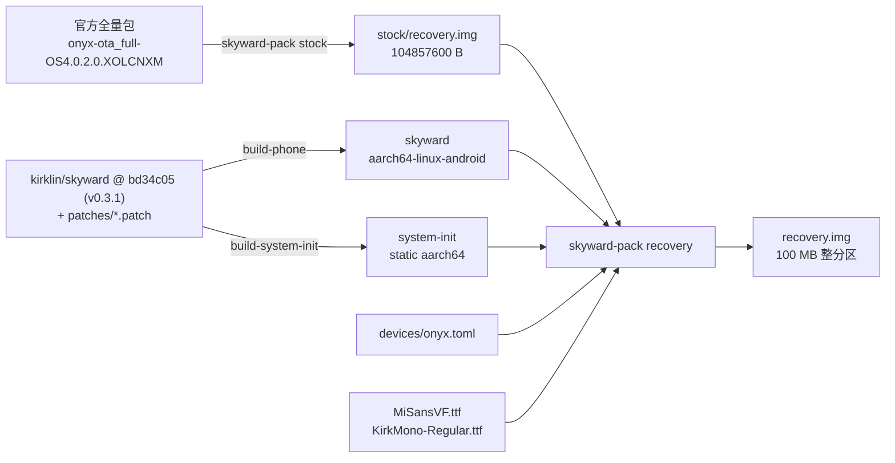
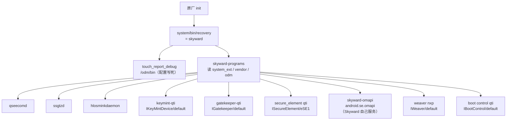
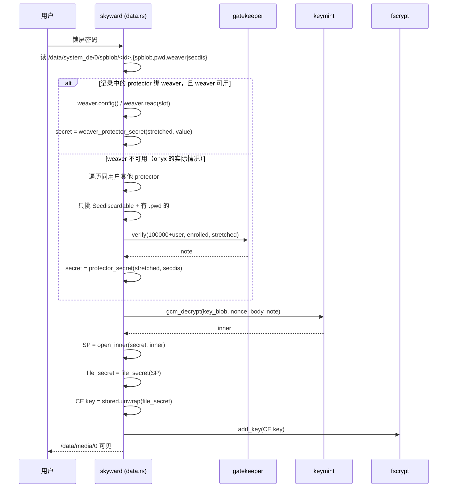
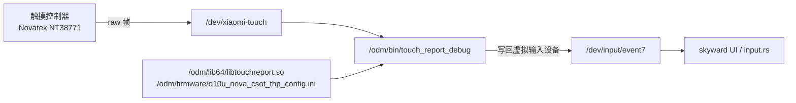

# 架构

> 状态：**现行**
> 对应版本：`v0.3.1-onyx.1`
> 读者：要改代码 / 要判断某个现象该看哪一层的人。

---

## 1. 全景

Skyward 的构建分两半：**宿主侧**把上游 Rust 源码编成打包器 `skyward-pack`；**手机侧**编出 `skyward` 和 `system-init`；最后用打包器把「原厂 recovery + 手机侧二进制 + 设备配置 + 字体」压成一个整分区镜像。



没有 AOSP 源码树，也没有 Gradle / Soong。打包器只做三件事：解原厂 ramdisk、替换 / 新增条目、按原分区大小重新压回去并写 AVB footer。

---

## 2. 镜像布局

`recovery.img` 是**整分区**镜像，不是 `boot.img`：

| 偏移 / 结构 | 值 |
| --- | --- |
| boot header | v4 |
| kernel | 0 字节（内核由 boot 分区提供，和原厂 recovery 一致） |
| ramdisk | 50,668,045 字节，LZ4 legacy 帧 |
| ramdisk 解压后 | 以 `verify-image.sh` / AVB footer 的实际值为准 |
| cpio 条目 | 1062（原厂 1051 + 新增 11） |
| 分区大小 | 104,857,600 字节（100 MiB） |
| AVB footer | 未签名，`OriginalImageSize` 指向真正内容大小 |

### ramdisk 里改了什么

`skyward-pack list recovery.img` 可以直接看：

| 条目 | 变化 | 说明 |
| --- | --- | --- |
| `system/bin/recovery` | 替换：stock → **8,955,824** 字节 | Skyward 本体（aarch64 PIE，解释器 `/system/bin/linker64`） |
| `skyward/` | 新增目录 | 设备配置、字体、system-init |
| `skyward/device.toml` | 新增 4,818 字节 | `devices/onyx.toml` 的副本，运行时读 |
| `skyward/system-init` | 新增 789,032 字节 | 静态可执行，安装第二系统时用 |
| `skyward/wpa-aidl-shim.so` | 新增 5,312 字节 | `LD_PRELOAD` 给 vendor supplicant，应答 recovery 不认的 AIDL 注册 |
| `skyward/MiSansVF.ttf` | 新增 20,093,424 字节 | UI 字体 |
| `skyward/KirkMono-Regular.ttf` | 新增 270,456 字节 | 终端字体 |
| `skyward/KirkMono-OFL.txt` | 新增 4,483 字节 | 终端字体许可 |
| `system/bin/7za` `avbctl` `resetprop` `zstd` | 新增符号链接 | 都指向 `system/bin/recovery`，由 skyward 按 argv[0] 分派 |
| `system/etc/init/skyward-mtp.rc` | 新增 1,223 字节 | MTP 的 init rc |
| `system/etc/task_profiles.json` | 新增 1,709 字节 | 性能配置 |
| `prop.default` | 追加 | `ro.secure=0`、`ro.adb.secure=0`、`ro.debuggable=1`、`ro.ota.allow_downgrade=true` |

> OS4 原厂 stock ramdisk 是 30,175,673 字节 / 1051 条；v0.3.1-onyx.1 是 50,668,045 字节 / 1062 条。旧 README 里写的「998 / 996 条」是 v2/v3 时期的数字；以 `skyward-pack list` 为准。

---

## 3. 启动与服务

init 仍然是原厂 recovery 的 init，它启动的 `system/bin/recovery` 变成了 Skyward。Skyward 读 `skyward/device.toml`：

1. 先按 `[[service]]` 拉起配置里写死的程序（onyx 只剩触摸服务）；
2. 再从**安装系统的分区**读 init 脚本与 VINTF 描述，发现「用手机密钥的那批程序」，按手机自己的顺序拉起：`skyward-programs` 负责解析，`crates/skyward/src/keys.rs` 负责运行时。



onyx 上 `skyward keys` 实际发现的顺序（0.3.1-onyx.1 真机）：

| 程序 | 用户/组 | 就绪条件 |
| --- | --- | --- |
| `/vendor/bin/qseecomd` | root / root drmrpc | `vendor.sys.listeners.registered`（带 socket `notify-topology`） |
| `/vendor/bin/ssgtzd` | system / system oem_2912 wakelock | 无（两个 socket） |
| `/vendor/bin/hlosminkdaemon` | system / system | 无（socket `hlos_mink_opener`） |
| `/vendor/bin/hw/android.hardware.security.keymint-service-qti` | system / system drmrpc | `...IKeyMintDevice/default`，另注册 secureclock / sharedsecret / remotelyprovisioned |
| `/vendor/bin/hw/android.hardware.gatekeeper-service-qti` | system / system | `...IGatekeeper/default` |
| `/vendor/bin/hw/android.hardware.secure_element-service.qti` | system / nfc system | `...ISecureElement/eSE1` |
| `android.se.omapi.ISecureElementService/default` | — | Skyward 自己服务的 OMAPI 桥 |
| `/odm/bin/hw/android.hardware.weaver-service.nxp-qti` | vendor_nxp_weaver / vendor_nxp_weaver | `...IWeaver/default`（WAKE_ALARM） |
| `/vendor/bin/hw/android.hardware.boot-service.qti` | root / root | `...IBootControl/default` |

安全性相关的点：

- 这些程序从**安装系统**的 `system_ext` / `vendor` / `odm` 分区读，recovery 只读挂载，不改手机上的文件；
- 程序加载的库目录：`/system/lib64`、`/vendor/lib64`，以及 `0003` 补上的 `/vendor/lib64/hw`、`/mnt/system/system/lib64`、`/mnt/system/system/lib64/bootstrap`。Android 17 recovery 没有 `libvndksupport.so`，不加这一条 keymint 会 exit 1（见 [`06-pitfalls.md`](06-pitfalls.md)）；
- `/system/etc/vintf/manifest/` 里不能留任何坏文件——一个坏文件会让整份清单变 NULL，所有服务注册失败；
- 配置里只剩触摸服务：`[[service]]` 只有一个 `touch_report_debug`（读 `/dev/xiaomi-touch` raw 帧，经 `libtouchreport.so` 合成触摸事件）。

---

## 4. data 解密链路

Android 的 `/data` 有两层：

1. **设备级（DE / metadata）**：`/data` 整体用 dm-default-key 加密，密钥由 keymint 解出。v3 起这项已通，开机自动挂载。
2. **用户级（CE）**：每个用户的 `/data/media/<user>`、`/data/data` 等用 per-user CE key 加密；CE key 存在 `/data/misc/vold/user_keys/ce/<user>/current`，外面包着 `encrypted_key`，由**合成密码（SP）派生的 file secret** 做软件包裹。

Skyward 要做的是：从用户输入的锁屏密码拿到 SP，解出 CE key，再 `add_key` 到 fscrypt keyring，`/data/media/0` 才会出现真实文件名。

### v4 的实际路径



关键常量（`crates/skyward-crypto/src/data.rs`）：

| 常量 | 值 | 含义 |
| --- | --- | --- |
| `TYPED_SLOT` | `100_000` | 用户输入的凭据登记在「用户号 + 100000」的 gatekeeper slot |
| `PROTECTORS` | `/data/system_de` | protector 根目录 |
| `BLOBS` | `spblob` | 每个用户的 blob 目录 |
| `SECRET_HANDLE` | `0000000000000000.handle` | 安全世界给用户 secret 的 handle |
| `USER_KEYS` | `/data/misc/vold/user_keys` | CE key 所在 |
| `MOUNT` | `/data` | fscrypt 挂载点 |

### 为什么两份 protector 都能开

`spblob` 里的 `inner` 是同一个 SP 的密文，差别只在「谁保管解它的 secret」：

- weaver 绑定：secret 由 eSE 槽位 1 的值 + stretched credential 派生；
- secdiscardable 绑定：secret 由 `.secdis` 的字节 + stretched credential 派生，凭据由 gatekeeper 校验。

两份 `.pwd` 的 salt / scrypt 参数相同，所以**同一个锁屏密码**都能算出同一个 `stretched`；SP 在改锁屏密码时不变，CE 的 `encrypted_key` 又是 SP 派生的 file secret 包的，所以从任意一份拿到 SP 都能解 CE key。

v4 的补丁只改 `data.rs` 一个文件：把 `protector()` 拆成 `protector_ids()` / `protector_named()`，把 `open_user_files()` 拆出 `open_with_protector()`，并在 weaver 不可用时按上面的条件回退。完整分析见 [`05-design-notes.md`](05-design-notes.md)。

---

## 5. OMAPI 桥（上游自带，非 user 0 必需）

0.3.0 时我们自己用 `patches/0002` 给 binder 补服务端，再写 `omapi.rs`；**0.3.1 起这两样都在上游**：

- `crates/skyward-binder/src/serve.rs` 提供服务端（收 `BR_TRANSACTION`、回 `BC_REPLY`、等回调、传 binder 对象）；
- `crates/skyward-omapi/` 实现 `android.se.omapi.ISecureElementService/default`，把 `getReaders` / `openSession` / `transmit` 等转发到 `android.hardware.secure_element.ISecureElement/eSE1`；
- 发现流程里有一个 `serve android.se.omapi.ISecureElementService/default` 步骤，keymint 那批程序就绪后自己起桥。

真机日志（0.3.1-onyx.1）：

```
skyward: omapi: have the secure element's service start: the service refused the call with its error 1
skyward: android.se.omapi.ISecureElementService/default is served, with a reader for each of 1 secure elements: eSE1
```

user 0 仍然走 `0002` 的 gatekeeper 回退，不依赖 OMAPI；保留桥的目的是 user 999（只有 weaver 绑定的 protector）与排错。**不要**在没看护时把 user 999 直接接到主流程里。

---

## 6. 触摸链路

onyx 的触摸不是标准的 `/dev/input/eventN`：



实测：直接 `getevent /dev/input/event7` 90 秒、用户滑动，**零事件**；把 `enable_touch_raw` 从 1 改 0、重刷触摸固件都没有用。拉起 `touch_report_debug` 后触摸立即恢复。onyx 的 ODM 里**没有** `touch_report`，只有 `touch_report_debug`。

---

## 6.5 WLAN 链路

```
[modules] sources（vendor_boot / vendor_dlkm / vendor / system_dlkm）
  → rfkill（system_dlkm，cfg80211 的依赖）
  → qca_cld3_wcn7750（vendor_dlkm，依赖 icnss2 / cnss_utils / cfg80211 …）
  → 写 /sys/kernel/icnss/wlan_en_delay、wpss_boot
  → 固件从 /vendor/firmware/wcn7750 由 ueventd 加载
  → /etc/firmware/wlan/qca_cld/wcn7750/{WCNSS_qcom_cfg.ini,wlan_mac.bin}（从 vendor / persist 拷）
  → wlan0
  → /vendor/bin/hw/wpa_supplicant（LD_PRELOAD=skyward/wpa-aidl-shim.so）
  → per-interface SOCK_DGRAM control socket（/skyward/run/supplicant/sockets/wlan0）
  → SCAN / ADD_NETWORK / SET_NETWORK / SELECT_NETWORK / DHCP
```

`wpa-aidl-shim.so` 只覆盖 `AServiceManager_addService`，返回 0。recovery 的 servicemanager / VINTF 不认 vendor 的 AIDL 服务，原返回值是 `-129`（`EX_TRANSACTION_FAILED`）；Skyward 不使用 AIDL，所以只需要 supplicant 继续走到 per-interface socket。

## 6.6 振动链路

AW8697（`awinic_haptic`）在 i2c `5-005a`，input `event5` 有 FF，但它的自定义波形格式是 Awinic 的 RTP / waveform，不是 qcom 的裸 i8 采样。因此 `haptics.rs` 新增 sysfs 后端：

```
/sys/bus/i2c/devices/5-005a/effect_id  ← 0
/sys/bus/i2c/devices/5-005a/duration   ← 16（点击）/ 10（熄屏 ticks）ms
/sys/bus/i2c/devices/5-005a/gain       ← 0x00–0x80
/sys/bus/i2c/devices/5-005a/activate   ← 1，睡 duration，再写 0
```

设置页的滑杆与触摸反馈都走 `Haptics::click`；`skyward haptic` 可直接测。

## 7. 补丁文件级说明

| 补丁 | 文件 | 改了什么 | 为什么 |
| --- | --- | --- | --- |
| `0001-windows-host-build.patch` | `skyward-bootimg/src/ramdisk.rs`、`skyward-pack/{Cargo.toml,src/main.rs}` | 给 Unix-only 函数加 `#[cfg(unix)]`；把 `described` 子命令做成 feature 门控 | 宿主打包器只走内存 cpio；`described` 依赖的 `skyward-programs` 在 Windows 上编不过 |
| `0002-onyx-ce-fallback.patch` | `skyward-crypto/src/data.rs` | 拆 `protector_ids` / `protector_named`；`open_user_files` 在 `WeaverUnusable` 时回退；抽出 `open_with_protector` | onyx user 0 有第二份 gatekeeper 绑定的 protector，不需要 weaver 就能拿 SP |
| `0003-onyx-config-wlan-haptics.patch` | `skyward-config/src/lib.rs`、`skyward-programs/src/secure.rs`、`skyward/src/{haptics,main,settings,wlan}.rs` | 配置新增 `[wlan] preload` / `[update] skyward` / 振动四路径；`/vendor` 程序的库目录补上安装系统的 `/system/lib64` 与 bootstrap；WLAN 5 GHz 与自动连接；AW8697 振动；设置持久化；首屏解密页 | onyx 的设备差异 + 0.3.1 自动发现密钥服务的库路径修复 |
| `0004-onyx-updates-downloads.patch` | `skyward-net/src/{download,github,http,supplicant}.rs`、`skyward/src/updates.rs` | 512 连接并行下载、DNS 缓存、自更新仓库可配、优先裸 `recovery.img`、本地 `recovery.img` 刷入 | GitHub 直连单连接约 40 KB/s，45.85 MB 要 17 分钟 |
| `0005-onyx-ui.patch` | `skyward-ui/**`、`skyward-preview/src/main.rs`、`skyward/src/ui.rs` | 锁屏（模糊快照、强度滑杆、滑块重画）、首页读数、解密页倒计时 / 记住密码、下载页 / 二维码 / 纯文本网页、更新页、双击亮屏、AVB 页、面板不 rest | onyx.1–onyx.5 的 UI 全部移植到 0.3.1 的 `app/*` 状态机 |
| `0006-onyx-version.patch` | `Cargo.toml`、`Cargo.lock` | 版本 `0.3.1-onyx.1` 与依赖锁 | 发布与自更新版本比较 |

补丁顺序固定，`scripts/bootstrap.sh` 按 `0001 → 0006` 应用。上游 commit 与每个补丁的说明见 [`patches/README.md`](../patches/README.md)。

---

## 8. 设备配置（`devices/onyx.toml`）

| 段 | 关键值 | 说明 |
| --- | --- | --- |
| `[device]` | `codename = "onyx"`、`ab = true`、`os_version_prop` | 设备身份与系统版本来源 |
| `[display]` | 1280 × 2772、density **512**、6.83" | 400 dp 宽；按屏高反推 1109 会让 UI 溢出 |
| `[modules]` | `sources = vendor_boot, vendor_dlkm, vendor, system_dlkm`；`load = nt38771_touch, xiaomi_touch` | 触摸与分区模块 |
| `[[service]]` × 1 | 见第 3 节 | 只剩触摸；密钥服务由 `skyward-programs` 从系统分区发现 |
| `[update]` | MIUI 更新服务器 + `skyward = "Remoparrot/skyward-onyx"` | 系统更新 + Skyward 自身更新 |
| `[wlan]` | `qca_cld3_wcn7750` + `rfkill`；`wpss_boot`；`preload`；系统优先的 `libraries` | WLAN 驱动、固件、supplicant |
| `[haptics]` | AW8697 的 `activate` / `duration` / `effect_id` / `gain` | 振动 |
| `[stock]` | `OS4.0.2.0.XOLCNXM`、全量包 URL、recovery SHA-256 | `skyward-pack stock` 用它按需取原厂 recovery |

---

## 9. 运行时目录

| 路径 | 内容 |
| --- | --- |
| `/skyward/device.toml` | 配置副本（ramdisk 内） |
| `/data/system_de/<user>/spblob/` | protector blobs（`.spblob` / `.pwd` / `.weaver` / `.secdis`） |
| `/data/misc/vold/user_keys/ce/<user>/current` | CE key（`encrypted_key` + `version`） |
| `/data/media/<user>` | 用户共享存储 |
| `/tmp` | 开发时 adb push 的临时二进制；不随镜像 |
| `/sys/fs/pstore` | 崩溃后的内核日志；黑屏排查先看这里 |

---

## 10. 相关文档

- 构建命令：[`03-build.md`](03-build.md)
- 刷入 / 回滚：[`04-install.md`](04-install.md)
- 为什么这样设计：[`05-design-notes.md`](05-design-notes.md)
- 踩过的坑：[`06-pitfalls.md`](06-pitfalls.md)
